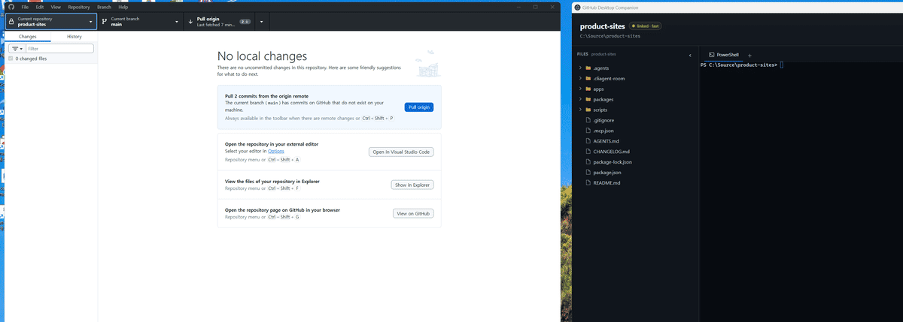

# GitHub Desktop Companion

GitHub Desktop에서 선택한 Repository를 따라다니며 해당 프로젝트의 파일과 터미널을
자동으로 전환하는 Windows용 로컬 개발 Companion이다.

> 현재는 초기 프로토타입이다. Windows용 설치 파일과 포터블 실행 파일을 만들 수
> 있지만 안정적인 공개 릴리스와 자동 업데이트는 아직 제공하지 않는다.

[](docs/assets/companion-demo.mp4)

GitHub Desktop에서 Repository를 선택하면 Companion의 파일 트리와 Repository별
터미널 세션이 즉시 따라간다. 이미지를 누르면 MP4로 볼 수 있다.

## 주요 기능

- GitHub Desktop에서 현재 선택한 Repository 자동 감지
- Repository가 바뀌면 파일 트리와 터미널을 함께 전환
- Repository별 파일 트리 펼침, 스크롤, 패널 상태 보존
- Repository별 다중 PTY 터미널 탭과 출력 유지
- 파일 열기, Explorer에서 보기, 경로 복사
- Windows PowerShell 터미널과 실험적인 WSL Linux 실행

## 감지 방식

빠른 연결 모드에서는 Windows UI Automation으로 GitHub Desktop의 선택 변경을 읽는다.
이 모드를 사용하려면 Companion의 실행 버튼으로 GitHub Desktop을 접근성 옵션과 함께
시작해야 한다. 이미 일반 모드로 실행 중이라면 버튼이 재시작 여부를 안내한다.

UI Automation을 사용할 수 없을 때는 GitHub Desktop의 Chromium Local Storage와
IndexedDB를 읽는 지연 모드로 전환한다. 이 방식은 GitHub Desktop의 비공개 내부 저장
구조에 의존하므로 버전 변경에 따라 감지기 수정이 필요할 수 있다.

## 설치해서 사용하기

[GitHub Releases](https://github.com/ddunddun-labs/RepoSide/releases/latest)에서 다음 중
하나를 내려받아 사용할 수 있다.

- `GitHub Desktop Companion-Setup-...exe`: 현재 사용자 계정에 설치하고 바탕 화면과
  시작 메뉴에 바로가기를 만든다.
- `GitHub Desktop Companion-Portable-...exe`: 설치 없이 바로 실행한다.

아직 코드 서명을 적용하지 않았기 때문에 Windows SmartScreen 경고가 나타날 수 있다.
공식 GitHub Releases에서 받은 파일인지 확인한 뒤 실행해야 한다. 앱을 실행한 다음
화면의 **Launch GitHub Desktop** 버튼을 사용하면 빠른 Repository 감지가 활성화된다.

## 사용자 요구 사항

- Windows 10/11
- GitHub Desktop (개발 중 3.6.4에서 확인)

설치 파일이나 포터블 버전을 사용하는 일반 사용자에게 Node.js는 필요하지 않다.

## 개발 요구 사항

- Node.js 22.12 이상

## 개발 실행

저장소를 clone한 뒤 Windows PowerShell에서 실행한다.

```powershell
cd github-desktop-companion
npm ci --include=optional
npm run dev
```

WSL과 Windows는 네이티브 의존성 구성이 다르다. 같은 작업 디렉터리에서 두 환경의
`npm install`을 번갈아 실행하지 않는 것을 권장한다.

검증 명령은 다음과 같다.

```powershell
npm run typecheck
npm run build
```

Windows 배포 파일은 다음 명령으로 만든다.

```powershell
npm run dist:win
```

결과물은 `github-desktop-companion/release`에 생성된다.

## 저장소 구조

```text
github-desktop-companion/      Electron 앱
github-desktop-companion-poc/  저장소 감지 진단 CLI
```

## 현재 한계

- Windows와 GitHub Desktop의 내부 구현에 의존한다.
- 공식 지원 운영체제는 Windows이며 WSL Linux 실행은 실험적이다.
- Windows 앱의 cmd와 WSL 터미널 프로필 선택은 아직 지원하지 않는다.
- 같은 이름의 Repository가 여러 개면 빠른 UI 감지가 모호할 수 있다.
- 코드 서명된 설치 프로그램과 자동 업데이트는 아직 없다.
- GitHub Desktop이 일반 모드로 실행 중이면 지연 감지를 사용하거나 재시작해야 한다.

## 기여와 보안

기여 방법은 [CONTRIBUTING.md](CONTRIBUTING.md), 보안 문제 제보 방법은
[SECURITY.md](SECURITY.md)를 참고해줘.

## 라이선스와 상표

[MIT License](LICENSE)로 배포한다.

이 프로젝트는 GitHub, Inc.와 제휴하거나 GitHub의 승인을 받은 공식 제품이 아니다.
GitHub와 GitHub Desktop은 각 소유자의 상표다.
